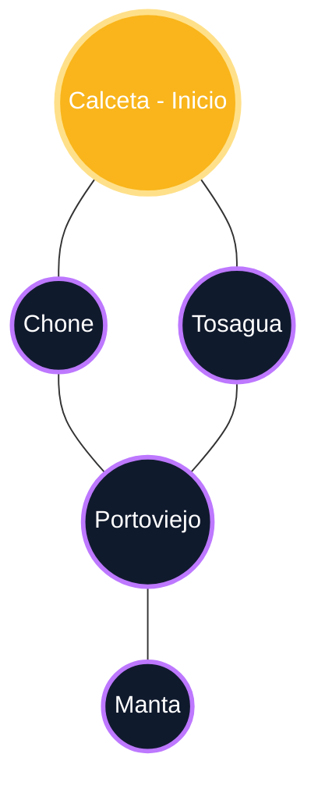

# Exposición y Depuración Docente: Grafos, Lista de Adyacencia y Búsquedas BFS/DFS

**Asignatura:** Estructuras de Datos y Algoritmos (CDS-0202)  
**Carrera:** Desarrollo de Software • Modalidad En Línea  
**Sesión:** Clase 10 (Unidad 2)  

## Descripción del Proyecto
Código pedagógico para la exposición y demostración interactiva en el aula virtual de:
1. Representación de Grafos no dirigidos mediante **Lista de Adyacencia** (`List<List<Integer>>`).
2. Algoritmo de **Búsqueda en Amplitud (BFS)** utilizando una Cola (`Queue FIFO`) para explorar nivel por nivel.
3. Algoritmo de **Búsqueda en Profundidad (DFS)** utilizando recursión/pila para explorar rama por rama hasta el fondo antes de retroceder (*backtracking*).

## Compilación y Ejecución en Consola
```powershell
# 1. Compilar clases
javac -d bin src/*.java

# 2. Ejecutar
java -cp bin Main
```

## Grafo en vista visual

El siguiente gráfico muestra **Calceta** como origen y conserva todas las
conexiones del grafo no dirigido:



La conexión `Tosagua ↔ Portoviejo` se muestra porque pertenece al grafo
original, aunque no se repita cuando se construye el árbol de recorrido BFS.

### Lista de adyacencia

```text
Calceta (0)     → Chone (1), Tosagua (2)
Chone (1)       → Calceta (0), Portoviejo (3)
Tosagua (2)     → Calceta (0), Portoviejo (3)
Portoviejo (3)  → Chone (1), Tosagua (2), Manta (4)
Manta (4)       → Portoviejo (3)
```
